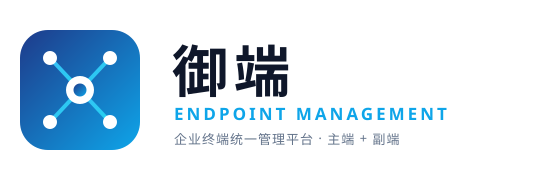
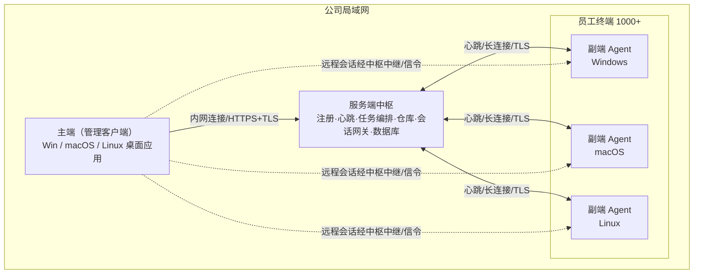

# 终端统一管理平台（主端 + 副端）产品策划文档

| 项目 | 内容 |
|---|---|
| 文档名称 | 企业终端统一管理平台产品策划文档（PRD） |
| 版本 | v1.1 |
| 适用对象 | IT 运维负责人、研发团队、项目管理 |
| 当前规模基线 | 1000+ 台员工终端，Windows / macOS / Linux 混合（主端/副端全平台） |
| 部署环境 | 公司局域网（LAN），服务端中枢部署于公司机房/内网 |
| 产品品牌 | 御端（YùDuān）· 企业终端统一管理平台 |

---

## 0. 产品命名与品牌

### 产品名称
- **中文名**：御端（YùDuān）
- **英文名 / 缩写**：Yudu（品牌缩写 **YD**）
- **定位口号**：企业终端统一管理平台 · 主端 + 副端
- **命名释义**：「御」取统御、管控之意，「端」即终端/端点；合起来表达"集中统御企业所有终端"，与产品的主端管控、副端受管模型高度契合。

> 备选名称（供参考，未采用）：**瞰端**（centralized oversight，俯瞰管控）、**枢维**（枢纽 + 运维）。

### 品牌 Logo

Logo 设计说明：
- **造型**：圆角方形徽标内为「中枢—端点」网络图（中心枢纽连接四个分布端点），直观表达"主端集中管控、副端分布受管"的产品模型；外框渐变蓝（深蓝 #1E3A8A → 天蓝 #0EA5E9）传达专业、可信、科技感。
- **字体**：右侧「御端」中文字标 + 英文「ENDPOINT MANAGEMENT」+ 副标题「企业终端统一管理平台 · 主端 + 副端」。
- **格式**：矢量 SVG（logo-yuduan.svg），可无损缩放，适用于控制台、安装包、文档与印刷。

---

## 1. 项目背景与痛点

公司现有 1000+ 名员工电脑，当前以"逐台人工维护"为主，存在以下核心痛点：

1. **维护成本高**：软件安装、补丁更新、故障排查逐台进行，人力不可持续。
2. **资产不清**：硬件/软件资产靠人工盘点，离职回收、设备调拨无闭环。
3. **远程支持难**：员工报障后 IT 无法快速接入，依赖员工自行操作或到场。
4. **软件分发低效**：新软件/新版本靠 U 盘或员工自助，版本混乱、合规难控。
5. **安全不可视**：违规软件、外设滥用、补丁缺失无法及时发现与处置。

**目标**：构建一套"主端集中管控 + 副端全员预装"的局域网终端管理平台，实现资产管理、远程控制、软件/文件分发、合规审计的一体化，将单台维护成本降至可接受水平。

---

## 2. 产品定位与目标

- **定位**：面向中大型企业内网的轻量级终端管理（Endpoint Management）平台，对标"向日葵远程 + SCCM/Intune 资产与分发"的内网融合方案。
- **核心目标**：
  - 资产 100% 纳管，自动盘点、变更可追踪；
  - 远程支持分钟级接入，降低现场成本；
  - 软件/文件一键下发，版本统一、状态可查；
  - 合规基线可检查、违规可告警、操作可追溯。

---

## 3. 目标用户与角色

| 角色 | 职责 | 主端权限 |
|---|---|---|
| 超级管理员 | 系统配置、组织架构、权限分配 | 全部 |
| IT 运维工程师 | 远程支持、软件分发、资产维护 | 远程控制、分发、资产查看 |
| 安全合规员 | 合规基线、告警处置、审计 | 只读 + 告警处置 |
| 部门管理员（可选） | 仅管理本部门终端 | 本部门范围受限权限 |
| 普通员工 | 被管理人员终端使用者 | 无管理权限，仅接收通知 |

---

## 4. 整体架构设计

### 4.1 部署拓扑（三层：主端客户端 / 服务端中枢 / 副端 Agent）

### 4.2 主端（管理客户端，跨平台桌面应用）

- **客户端形态（C/S）**：管理员在 Windows / macOS / Linux 上安装主端桌面客户端，集"管理控制台 + 远程桌面 viewer"于一体；原生渲染远程画面、低延迟输入，性能优于浏览器方案。
- **实现建议**：基于 Tauri（Rust，体积小、资源省）或 Electron 承载跨平台壳；UI 层统一，底层屏幕编解码、输入注入、系统调用按平台实现。备选 Qt（C++）纯原生方案。
- **与服务端中枢的关系**：主端客户端通过内网连接公司中枢服务端，获取资产/任务数据、发起远程会话、下发指令；远程画面经中枢中继（跨网段）或信令协商后 LAN 直连，客户端不直接暴露副端地址。
- **多端一致**：三平台功能与交互对齐，管理员可在任意办公设备使用主端。

### 4.3 服务端中枢（公司内网控制平面）

- **职责**：设备注册、心跳调度、命令下发、任务编排、文件/软件仓库管理、远程会话信令与画面中继网关、账号权限。
- **数据存储**：
  - 关系型数据库：资产、策略、任务、日志、账号权限。
  - 对象存储/NAS：安装包、下发文件、远程录像。
- **高可用**：双机热备/负载均衡，避免单点故障。

### 4.4 副端（受管 Agent，跨平台系统服务）

- **系统级常驻**：Windows 服务 / macOS launchd / Linux systemd，开机自启、无界面、低资源占用。
- **核心能力模块**：
  - 资产采集（硬件、软件、网络、安全状态）；
  - 心跳与状态上报；
  - 命令执行引擎（远程控制、软件静默安装、脚本、文件收发）；
  - 屏幕采集与输入注入（远程控制，三平台实现）；
  - 本地策略执行与合规自检。
- **自我保护**：防卸载/防停止（需管理员授权码或控制台远程解除），防篡改校验。

### 4.5 通信与安全通道

- **链路**：终端 ↔ 中枢、主端 ↔ 中枢一律 TLS 加密；远程会话媒体流经中枢中继或 LAN 直连（均加密）。
- **连接模式**：终端周期性心跳 + 长连接（WebSocket/gRPC），保证指令实时可达。
- **指令签名**：关键指令（远程控制、卸载、策略变更）服务端签名，副端验签后执行，防止伪造。
- **局域网优先（当前范围）**：所有通信在公司内网完成，不出公网，降低暴露面。
- **公网远程控制为远期目标（P2）**：当前 MVP 与一、二期均仅限局域网；公网穿透/远程接入列入远期规划，**不在本期实现范围内**。

---

## 5. 功能需求规划（核心）

> 优先级说明：P0 = 必备（MVP）；P1 = 重要（二期）；P2 = 增强（远期）。

### 5.1 终端资产管理（P0）

- [ ] 自动采集硬件资产：CPU、内存、磁盘、主板序列号、MAC/IP、显示器、装机时间。
- [ ] 自动采集软件资产：已安装软件清单、版本、安装来源、许可证信息（可手动补充）。
- [ ] 资产台账与分组：按部门/楼层/批次分组，支持自定义标签。
- [ ] 资产变更告警：硬件变动（如硬盘/内存更换）、长期离线、IP 冲突检测。
- [ ] 生命周期管理：领用、调拨、归还、报废状态流转；离职自动标记回收。
- [ ] 资产报表导出：Excel/PDF，支持按部门、时间维度统计。

### 5.2 远程控制（向日葵式，P0）

- [ ] 实时屏幕查看（只读围观）。
- [ ] 远程桌面控制：鼠标、键盘、多显示器切换、Ctrl+Alt+Del 直达。
- [ ] 内嵌文件传输：远程会话内双向传文件。
- [ ] 会话内聊天/备注：运维与员工文字沟通。
- [ ] 会话录制：全程录像存证，可回放审计。
- [ ] 水印与黑屏：会话期间屏幕叠加水印；可设置远端黑屏/锁屏防窥视。
- [ ] 会话通知：远端员工端弹出"管理员正在远程协助"提示（合规与知情）。
- [ ] 权限分级与审批：按角色授权谁能控制谁；敏感设备远程需二级审批。
- [ ] 并发与会话管理：支持多管理员同时多会话，会话列表、强制结束、超时断开。
- [ ] 画质/带宽自适应：LAN 高画质，弱网自动降码率。

### 5.3 软件分发（P0）

- [ ] 软件仓库：上传安装包（exe/msi/dmg/pkg），维护名称、版本、适用系统。
- [ ] 静默安装：支持安装参数模板（如 `/S`、`/quiet`）、自定义命令行。
- [ ] 分发任务：选择目标（单台/分组/全员）、计划时间（立即/定时/空闲时）。
- [ ] 安装方式：强制安装 / 员工可选安装（弹窗提醒）。
- [ ] 状态反馈：已下发、安装中、成功、失败（含错误码）、已跳过；失败自动重试。
- [ ] 版本管理与升级：检测已装版本，差异升级；支持卸载旧版本。
- [ ] 卸载与回收：远程批量卸载指定软件。

### 5.4 文件分发与采集（P1）

- [ ] 文件/目录下发：推送到终端指定路径（如桌面公告、配置模板）。
- [ ] 文件采集：从终端拉取指定文件/目录到服务器（日志、报表、取证）。
- [ ] 定时/触发同步：按策略周期性同步（如每日收集防病毒日志）。
- [ ] 传输校验：断点续传、完整性校验（哈希）。

### 5.5 远程命令与脚本（P1）

- [ ] 即时命令：在终端执行单条命令（CMD/PowerShell/Shell）。
- [ ] 脚本下发：批量执行脚本（重启服务、清理缓存、配置修改）。
- [ ] 执行结果回收：输出日志回传，异常高亮。
- [ ] 危险操作保护：删除、格式化等高危命令需二次确认 + 审批。

### 5.6 终端安全与合规（P1）

- [ ] 合规基线检查：操作系统补丁、杀毒软件状态、防火墙、屏保锁屏策略。
- [ ] 违规软件检测：游戏、P2P、未授权工具黑名单识别与告警。
- [ ] 外设管控：USB 存储、光驱、蓝牙的可开关策略（按部门）。
- [ ] 网络准入（可选）：不合规终端限制访问内网资源。
- [ ] 漏洞与补丁：系统/软件漏洞扫描，补丁分发闭环。

### 5.7 策略中心（P1）

- [ ] 策略模板：软件白/黑名单、补丁策略、外设策略、远程控制权限模板。
- [ ] 分组策略下发：按部门/角色差异化生效。
- [ ] 策略生效与回滚：灰度发布、失效回滚、生效结果统计。

### 5.8 告警与审计（P0/P1）

- [ ] 实时告警：离线、资产变更、合规不达标、远程异常（如非工作时间远控）。
- [ ] 操作审计：谁、何时、对哪台设备、做了什么（远程、分发、命令）。
- [ ] 远程录像审计：录像按"谁/何时/哪台"索引，访问需权限。
- [ ] 日志留存与导出：符合合规留存期限，支持导出。

### 5.9 报表与统计（P1）

- [ ] 资产覆盖率、在线率、软件合规率、漏洞分布、远程使用统计。
- [ ] 自定义报表与定时邮件推送。

### 5.10 系统管理（P0）

- [ ] 组织架构同步：支持对接 AD/LDAP/企业微信/钉钉，自动分组。
- [ ] 账号与角色权限（RBAC）：细粒度权限分配。
- [ ] 副端批量部署：镜像预装、域推送、扫码/链接安装；安装即纳管。
- [ ] 服务端中枢高可用：双机热备/负载均衡，避免单点故障；主端客户端支持多管理员安装与自动更新。

---

## 6. 非功能性需求

| 维度 | 要求 |
|---|---|
| 性能/容量 | 支持 ≥2000 终端；心跳间隔 30–60s；控制台支持 ≥50 路并发远程会话；指令端到端时延 < 2s |
| 安全 | 全链路 TLS；指令签名验签；Agent 防篡改/防卸载；主端最小权限、访问审计；录像加密存储 |
| 兼容性 | Windows 7/10/11（x64）、macOS 12+、主流 Linux 发行版（Ubuntu/Debian/CentOS/RHEL 等）；域环境/工作组/Linux 均支持；中文环境为主 |
| 资源占用 | Agent CPU < 1%（空闲）、内存 < 80MB；不打扰员工正常使用 |
| 可靠性 | 服务端中枢高可用；Agent 崩溃自恢复；网络抖动指令重试 |
| 可维护性 | 模块化、日志完备、版本自检与自升级 |

---

## 7. 合规与隐私保护（重点）

> 即使设备属公司资产且已告知，屏幕采集、行为记录仍可能触及员工个人信息。建议按以下落地，确保合法、可持续：

1. **制度先行**：制定《员工电脑使用与远程管理告知书》，经民主程序（工会/职工代表）讨论并公示，员工签收确认。
2. **目的限制**：仅用于资产管理、故障支持、安全合规，不用于与用工管理无关的私生活窥探。
3. **最小必要**：远程屏幕/录像默认关闭，仅在"远程协助进行中"或"经审批的安全事件"开启；非必要不录像。
4. **知情与提示**：每次远程控制远端必须弹窗提示；录像访问需审批并留痕。
5. **数据留存**：录像与日志按"必要期限"留存（建议 30–90 天），到期自动清理。
6. **访问控制**：个人信息/录像仅授权角色可见，访问全审计。
7. **法律复核**：上线前由法务/合规对告知书、采集范围、留存策略做合规评审。

---

## 8. 部署与交付方案

- **服务端中枢**：公司内网服务器（物理机/虚拟机/容器），建议 2 台做高可用；数据库与主程序分离。
- **主端（管理客户端）**：分发给运维/安全管理员设备，Windows / macOS / Linux 三平台安装包，支持自动更新。
- **副端预装**：
  - 出厂/领用镜像内置 Agent（静默安装，开机自启）；
  - 存量设备通过域策略（GPO）/批处理/Ansible/邮件链接批量推送（含 Linux）；
  - 安装即自动注册纳管，无需员工操作。
- **网络**：纯内网通信；如需跨办公楼，通过公司 VPN/专线互联，仍不暴露公网。

---

## 9. 实施路线图

| 阶段 | 周期（估） | 范围 |
|---|---|---|
| **MVP（P0）** | 8–12 周 | 资产采集、远程控制（含录像/提示）、软件分发、系统管理、基础审计 |
| **二期（P1）** | 8–10 周 | 文件收发、命令脚本、合规基线、策略中心、报表、告警增强 |
| **三期（P2）** | 持续 | 外设管控、网络准入、漏洞补丁闭环、AI 异常检测、移动端控制台、**公网远程控制（远期目标，当前不涉及）** |

---

## 10. P0（MVP）研发任务清单（不含工时）

> 基于 P0 必备范围拆分的研发任务，按工作流分组，暂不估算工时。

### A. 基础设施与跨平台底座
- A1 服务端中枢搭建：设备注册、心跳调度、任务队列、指令签名、数据库 schema、对象存储接入
- A2 主端桌面客户端框架（Tauri/Electron）：跨平台壳、内网连接中枢、自动更新
- A3 副端 Agent 跨平台框架：Windows 服务 / macOS launchd / Linux systemd 常驻、自启、崩溃自恢复、防卸载/防篡改
- A4 通信层：TLS、长连接（WebSocket/gRPC）、心跳协议、指令验签
- A5 跨平台屏幕采集与输入注入抽象层：接口 + Win DXGI / macOS ScreenCaptureKit / Linux PipeWire·X11 实现
- A6 跨平台安装包：Windows NSIS/InnoSetup、macOS pkg、Linux deb/rpm/AppImage；静默安装

### B. 资产管理（P0）
- B1 硬件采集（CPU/内存/磁盘/序列号/MAC/IP/显示器）三平台
- B2 软件清单采集（已装软件/版本/来源）三平台
- B3 资产台账与分组（部门/标签）、生命周期状态流转
- B4 资产变更检测与告警（硬件变动/离线/IP 冲突）
- B5 资产报表导出（Excel/PDF）

### C. 远程控制（P0）
- C1 远程桌面 viewer（主端客户端内）：画面渲染、鼠标/键盘注入、多显示器
- C2 信令与画面中继（中枢网关 / LAN 直连协商）
- C3 编码器 H.264/H.265 与带宽自适应
- C4 会话内文件传输
- C5 会话聊天/备注
- C6 会话录制与回放
- C7 水印 / 远端黑屏锁屏
- C8 远端提示弹窗（合规知情）
- C9 权限分级与审批（谁能控谁、敏感设备二级审批）
- C10 并发与会话管理（多会话、强制结束、超时断开）
- C11 Ctrl+Alt+Del 直达（Windows）

### D. 软件分发（P0）
- D1 软件仓库（上传/版本/适用系统）
- D2 静默安装参数模板与自定义命令行
- D3 分发任务（目标选择/计划时间/强制或可选）
- D4 安装执行引擎（三平台静默安装/卸载）
- D5 状态反馈与失败重试
- D6 版本管理与升级、旧版卸载

### E. 系统管理（P0）
- E1 组织架构同步（AD/LDAP/企微/钉钉）
- E2 RBAC 账号与角色权限
- E3 副端批量部署（镜像预装/域推送/链接）与安装即纳管
- E4 服务端中枢高可用（双机热备/负载均衡）
- E5 主端客户端安装与权限管理（管理员使用）

### F. 告警与审计基础（P0）
- F1 操作审计日志（谁/何时/哪台/做了什么）
- F2 实时告警（离线/资产变更/远程异常）
- F3 远程录像审计索引与权限访问
- F4 日志留存与导出

### G. 合规与上线准备（P0）
- G1 《员工电脑使用与远程管理告知书》模板 + 远端提示文案
- G2 录像默认关闭/按需开启、留存期限与自动清理
- G3 法务合规评审配合（提供采集范围与留存说明）

---

## 11. 风险与对策

| 风险 | 对策 |
|---|---|
| 员工抵触隐私问题 | 合规告知 + 远端提示 + 最小采集 + 法务背书 |
| Agent 占用/冲突 | 低资源设计、灰度发布、崩溃自恢复 |
| 服务端中枢单点故障 | 高可用部署、数据库备份 |
| 指令伪造/越权 | TLS + 指令签名 + RBAC + 审计 |
| 大规模并发性能 | 长连接池、任务队列、分批下发 |
| 跨平台差异 | 抽象采集/控制接口，分平台实现与测试 |

---

## 12. 附录：技术选型建议（参考）

- **服务端中枢后端**：Go / Java / Node.js（高并发、易部署）；数据库 PostgreSQL/MySQL；对象存储 MinIO/NAS。
- **主端（管理客户端）**：Tauri（Rust，轻量）或 Electron 承载 React/Vue 前端；远程桌面 viewer 用原生模块（Rust/C++）做编解码与渲染；备选 Qt（C++）纯原生。
- **副端（Agent）**：C++/Rust/Go 系统服务；Windows 服务 + macOS launchd + Linux systemd；屏幕捕获 Windows 用 DXGI Desktop Duplication、macOS 用 ScreenCaptureKit、Linux 用 PipeWire（Wayland）/ X11 XShm（Xorg）。
- **通信**：gRPC / WebSocket + TLS；心跳 + 长连接。
- **远程桌面协议**：自研轻量协议（参考 RustDesk / Apache Guacamole 思路），LAN 内直连或经中枢中继，H.264/H.265 编码。
- **安装包**：Windows NSIS/InnoSetup（静默 `/S`）、macOS pkg、Linux deb/rpm/AppImage（静默 `-y`/`--silent`）。

---

### 需求清单汇总（按优先级）

- **P0（MVP 必备）**：资产管理、远程控制（查看/控制/文件传输/录像/提示/权限）、软件分发、系统管理（组织架构/RBAC/批量部署/主端客户端）、基础审计。
- **P1（二期重要）**：文件收发采集、远程命令脚本、合规基线、策略中心、报表统计、告警增强。
- **P2（远期增强）**：外设管控、网络准入、漏洞补丁闭环、AI 异常检测、移动端控制台、公网远程控制（远期目标，**当前 MVP 及一/二期均仅限局域网，不涉及公网**）。

> 本文档已将当前技术可实现的全部需求纳入规划，并基于 P0 拆出研发任务清单（第 10 章，不含工时）。下一步可估算工时并启动 MVP 原型。
