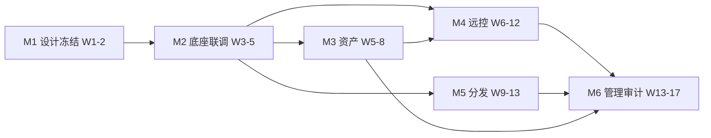

# 御端 · 终端统一管理平台 — 开发计划与排期

| 项目 | 内容 |
|---|---|
| 文档名称 | 御端终端统一管理平台开发计划与排期 |
| 版本 | v1.0 |
| 引用文档 | 《技术开发文档》v1.0（TDD，M1–M6）；《产品策划文档》v1.1（PRD，P0 任务 A–G） |
| 范围 | P0（MVP）全平台（Win / macOS / Linux）实现排期 |
| 说明 | 排期为规划假设，实际以团队规模与并行度调整；不含 P1/P2 |

---

## 1. 总体排期概览

按 TDD 第 14 章 M1–M6 拆分，采用**多轨并行**（中枢、主端、Agent 三队同步推进），关键路径为 M1 → M2 → M4 → M6。

| 里程碑 | 起止周 | 工期 | 对应 P0 任务 | 关键产出 |
|---|---|---|---|---|
| **M1 设计冻结** | W1–W2 | 2 周 | A1–A6 | 协议规范、DB Schema、跨平台接口契约 |
| **M2 底座联调** | W3–W5 | 3 周 | A2–A4 | 中枢/主端/Agent 端到端注册·心跳·指令 |
| **M3 资产管理** | W5–W8 | 4 周 | B1–B5 | 三平台资产采集 + 台账 + 报表 |
| **M4 远程控制** | W6–W12 | 7 周 | C1–C11 | 远控 viewer·中继·录制·权限·合规提示 |
| **M5 软件分发** | W9–W13 | 5 周 | D1–D6 | 仓库 + 静默安装 + 状态反馈 |
| **M6 管理与审计** | W13–W17 | 5 周 | E1–E5, F1–F4, G1–G3 | RBAC·AD 同步·高可用·合规上线 |
| **缓冲/验收** | W17–W19 | 2 周 | — | 试点、压测、缺陷收敛 |
| **合计** | — | **约 18–19 周（≈4.5 个月）** | — | — |

> 若采用「Windows 优先」策略（先单平台跑通再移植 Mac/Linux），MVP 可压缩至约 **12 周**；三平台全量按上表约 18–19 周。

---

## 2. 团队配置建议（排期基准）

| 角色 | 人数 | 主要负责 |
|---|---|---|
| 技术负责人 / PM | 1 | 架构定稿、排期、里程碑门禁 |
| 后端工程师 | 2 | 中枢、API、任务编排、仓库、RBAC |
| 主端客户端工程师 | 2 | Tauri 壳、React 控制台、远控 viewer |
| Agent 工程师 | 3 | 跨平台 Agent（Win / macOS / Linux 各 1，兼顾采集与远控子模块） |
| QA / 测试 | 1–2 | 功能、兼容、性能压测 |
| **合计** | **9–11 人** | — |

---

## 3. 详细里程碑计划

### M1 设计冻结（W1–W2，2 周）

- **目标**：冻结协议、数据模型与跨平台抽象接口，消除后续返工。
- **关键活动**：
  - 通信协议定稿（消息类型、JSON/二进制封装、HMAC 签名、seq 防重放）。
  - 数据库 Schema 评审（devices / tasks / sessions / RBAC / audit 等）。
  - 跨平台抽象接口契约：采集器接口、屏幕捕获接口、输入注入接口、安装执行接口。
  - 目录结构、CI/CD、编码规范落地。
- **交付物**：《接口与协议规范》《DB Schema v1》《跨平台接口契约》、仓库脚手架。
- **退出标准**：三平台接口签名确认；协议/Schema 评审通过；可编译空骨架。
- **依赖**：无。
- **风险**：接口契约遗漏导致 M2/M3 返工 → 要求架构师 + 三平台 Agent 负责人共同评审。

### M2 底座联调（W3–W5，3 周）

- **目标**：中枢、主端、Agent 三端连通，端到端跑通注册 / 心跳 / 指令。
- **关键活动（三轨并行）**：
  - 中枢：注册中心、WS 网关、心跳调度、指令下发骨架（A1/A4）。
  - 主端：Tauri 壳 + 登录 + 设备列表占位（A2）。
  - Agent：三平台常驻服务 + 启动自启 + 注册/心跳（A3）。
  - 通信层 TLS + 长连接 + 指令验签打通（A4）。
- **交付物**：可运行的"设备上线"闭环（Agent 注册、主端可见、可下发测试指令并回执）。
- **退出标准**：≥3 平台各 1 台测试机注册成功；心跳/指令往返 < 2s；签名验签生效。
- **依赖**：M1。
- **风险**：系统服务权限（macOS 授权、Linux systemd）卡点 → 提前准备签名/授权方案。

### M3 资产管理（W5–W8，4 周，与 M2 末重叠）

- **目标**：三平台资产采集、台账、报表可用。
- **关键活动**：
  - 硬件采集（CPU/内存/磁盘/序列号/MAC/IP/显示器）三平台（B1）。
  - 软件清单采集（B2）。
  - 台账与分组、生命周期状态（B3）。
  - 变更检测与告警（硬件变动/离线/IP 冲突）（B4）。
  - 报表导出 Excel/PDF（B5）。
- **交付物**：资产看板（主端）、差异上报、变更告警、导出。
- **退出标准**：三平台采集覆盖率 ≥95%；变更告警触发准确；报表可导出。
- **依赖**：M2。
- **风险**：Linux 发行版差异（lshw/dmidecode 权限）→ 分发行版适配清单。

### M4 远程控制（W6–W12，7 周，最长关键路径）

- **目标**：向日葵式局域网远控全能力，含合规提示与录制。
- **关键活动（分两组并行）**：
  - **采集/编码组（Agent）**：屏幕采集（DXGI / ScreenCaptureKit / PipeWire·X11）、H.264/H.265 编码、输入注入、Ctrl+Alt+Del（C1/C3/C11）。
  - **Viewer/信令组（主端 + 中枢）**：viewer 渲染、信令协商、LAN 直连/P2P 或中枢中继、带宽自适应（C1/C2/C3）。
  - **会话能力**：会话内文件传输（C4）、聊天（C5）、录制与回放（C6）、水印/黑屏锁屏（C7）、远端提示弹窗（C8）、权限分级与审批（C9）、并发与会话管理（C10）。
- **交付物**：可远控三平台设备、会话录制、权限审批、合规提示。
- **退出标准**：端到端远控可用；多显示器切换；录制可回放；远端弹窗必现；权限/审批生效；≥20 路并发无崩溃。
- **依赖**：M2（连通）；建议 M3 后（便于从资产列表选设备）。
- **风险**：
  - Wayland 采集需 PipeWire，部分发行版权限复杂 → 提前验证。
  - H.265 专利 → 评估 VP8/9 或 H.264 规避。
  - 输入注入安全桌面（Win SAS） → 走专用驱动/服务。

### M5 软件分发（W9–W13，5 周，与 M4 后段重叠）

- **目标**：仓库 + 三平台静默安装 + 状态反馈闭环。
- **关键活动**：
  - 软件仓库（上传/版本/适用系统）（D1）。
  - 静默参数模板与自定义命令行（D2）。
  - 分发任务（目标/计划/强制或可选）（D3）。
  - 三平台安装执行引擎（D4）。
  - 状态反馈与失败重试（D5）、版本管理与升级/卸载（D6）。
- **交付物**：仓库管理 UI、分发任务、执行回执、失败重试。
- **退出标准**：三平台静默安装成功；状态准确；失败自动重试；旧版可卸载。
- **依赖**：M2；与 M4 并行不冲突。
- **风险**：macOS 包类型多样（pkg/dmg/拖拽）→ 分类处理安装模板。

### M6 管理与审计（W13–W17，5 周，与 M5 末重叠）

- **目标**：权限、组织同步、高可用、合规上线就绪。
- **关键活动**：
  - 组织架构同步 AD/LDAP/企微/钉钉（E1）。
  - RBAC 账号与角色权限（E2）。
  - 副端批量部署（镜像/域推/Ansible）与安装即纳管（E3）。
  - 服务端中枢高可用（双机/负载均衡）（E4）。
  - 主端客户端安装与权限（E5）。
  - 操作审计日志、实时告警、录像审计索引、日志留存导出（F1–F4）。
  - 合规：《告知书》模板 + 远端提示文案、录像默认关/留存清理、法务评审配合（G1–G3）。
- **交付物**：RBAC 控制台、AD 同步、高可用部署、审计与告警、合规文档包。
- **退出标准**：RBAC 生效；AD 同步自动分组；中枢高可用切换成功；审计全留痕；合规评审通过。
- **依赖**：M3/M4/M5（需被管理对象与功能）。
- **风险**：法务评审周期 → G 类尽早启动，不压到末尾。

---

## 4. 依赖关系与关键路径

- **关键路径**：M1 → M2 → M4 → M6，约 **2 + 3 + 7 + 5 = 17 周**（加 M2/M3、M4/M5 的并行重叠后总工期约 18–19 周）。
- **最大并行度**：M4（远控）与 M5（分发）在 W9–W12 重叠；M5 与 M6 在 W13 重叠。中枢/主端/Agent 三队在 M2–M6 全程并行。

---

## 5. 资源与并行策略

- **中枢队**：M1 规范 → M2 骨架 → M3 资产服务 → M4 信令/中继 → M5 仓库/任务 → M6 RBAC/高可用。
- **主端队**：M1 契约 → M2 壳/登录 → M3 资产看板 → M4 viewer/远控台 → M5 分发中心 → M6 管理与审计 UI。
- **Agent 队（按平台）**：M2 常驻 → M3 采集 → M4 采集/注入 → M5 安装执行；三平台各自一条线，W6 起全面并行。
- **QA**：从 M2 介入冒烟，M3 起按平台建兼容矩阵，M4 起压测，M6 收口。

---

## 6. 里程碑评审门禁（Gate）

| 门禁 | 时间点 | 通过条件 |
|---|---|---|
| Gate M1 | W2 末 | 协议/Schema/接口评审签字 |
| Gate M2 | W5 末 | 端到端注册·心跳·指令打通 |
| Gate M3 | W8 末 | 三平台资产采集 ≥95% |
| Gate M4 | W12 末 | 远控全能力 + ≥20 路并发 |
| Gate M5 | W13 末 | 三平台静默安装闭环 |
| Gate M6 | W17 末 | RBAC/AD/高可用/合规通过 |
| 上线评审 | W19 末 | 试点（50–100 台）通过 + 压测达标 |

---

## 7. 风险与缓冲

| 风险 | 影响 | 缓解 |
|---|---|---|
| 跨平台远控采集差异（Wayland/PipeWire） | M4 延期 | W3 起专项验证，预留 1 周缓冲 |
| H.265 专利授权 | M4 成本/合规 | 优先 VP8/9 或 H.264 |
| macOS 授权/签名复杂 | M2/M3 卡点 | 提前准备开发者签名与 PPPC 配置 |
| 法务合规评审周期 | M6 阻塞上线 | G 类任务前移，W10 启动 |
| 1000+ 规模性能 | 上线风险 | M4 起压测，≥2000 终端心跳 + ≥50 路并发验证 |
| 人员变动/并行冲突 | 排期漂移 | 关键路径（M4）加 1–2 周缓冲 |

- **总缓冲**：W17–W19（2 周）用于试点、压测与缺陷收敛；关键路径额外预留约 1 周弹性。

---

## 8. 排期假设与可调项

- 本排期基于 **9–11 人团队、三平台全量**；若减员或单平台优先，需重估（单平台 MVP ≈12 周）。
- P1/P2（文件采集、命令脚本、合规基线、外设管控、公网远控等）不在本期，另排。
- 建议每双周一次里程碑同步，Gate 不通过不进入下一阶段。
