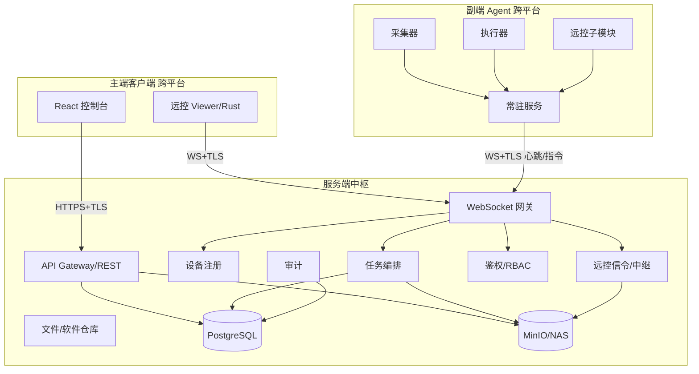

# 御端 · 终端统一管理平台 — 技术开发文档

| 项目 | 内容 |
|---|---|
| 文档名称 | 御端终端统一管理平台技术开发文档（TDD） |
| 版本 | v1.0 |
| 引用文档 | 《终端统一管理平台产品策划文档》v1.1（PRD） |
| 覆盖范围 | P0（MVP）必备能力的技术实现设计 |
| 网络范围 | 公司局域网（LAN）；公网远程控制为 P2 远期目标，本期不涉及 |

---

## 1. 文档说明

本技术开发文档（TDD）在 PRD v1.1 基础上，聚焦**实现层面**，覆盖 P0（MVP）必备能力：资产管理、远程控制、软件分发、系统管理、基础告警与审计。公网远程控制列为 P2 远期目标，不在本期设计范围。

---

## 2. 总体技术架构

### 2.1 技术栈总表

| 层级 | 组件 | 技术选型 | 说明 |
|---|---|---|---|
| 服务端中枢 | 后端服务 | Go（推荐）/ Java / Node.js | 高并发、易容器化 |
| 服务端中枢 | 关系数据库 | PostgreSQL | 资产/任务/账号/审计 |
| 服务端中枢 | 对象存储 | MinIO / NAS | 安装包、下发文件、录像 |
| 服务端中枢 | 消息/队列 | NATS / Redis Stream | 任务编排、心跳缓冲 |
| 主端客户端 | 桌面壳 | Tauri（Rust）/ Electron | 跨平台 Win/Mac/Linux |
| 主端客户端 | 前端 UI | React + TypeScript | 控制台与远控 viewer |
| 主端客户端 | 远控解码 | Rust 原生（scrap/ffmpeg） | 媒体渲染、低延迟 |
| 副端 Agent | 常驻服务 | Rust / Go / C++ | Win 服务 / macOS launchd / Linux systemd |
| 副端 Agent | 屏幕采集 | DXGI / ScreenCaptureKit / PipeWire·X11 | 三平台 |
| 通信 | 实时通道 | WebSocket + TLS | 心跳、指令、远控信令 |
| 通信 | 媒体通道 | UDP/RTP 或 TCP 中继 | 远控画面/输入 |

### 2.2 组件架构图



---

## 3. 通信与协议设计

### 3.1 连接拓扑
- **Agent → 中枢**：长连接 WebSocket（TLS），启动时注册，之后周期心跳（30–60s）+ 指令实时推送。
- **主端 → 中枢**：HTTPS（REST 管理） + WebSocket（实时事件/远控信令）。
- **远控会话**：信令经中枢协商（offer/answer/候选），媒体在 LAN 内 P2P 直连；跨网段经中枢 Relay 中转。全程加密。

### 3.2 消息封装
- 控制消息：`JSON over WebSocket`，含 `msg_id` / `type` / `ts` / `payload` / `sig`。
- 媒体消息：二进制帧（编码后的视频/输入事件），独立通道，带 `session_id` + `frame_seq`。

### 3.3 关键消息类型
| 类型 | 方向 | 说明 |
|---|---|---|
| `register` | Agent→Hub | 设备指纹、平台、版本、首次纳管 |
| `heartbeat` | Agent→Hub | 在线状态、负载、IP |
| `command` | Hub→Agent | `remote_control` / `sw_install` / `file_push` / `script_run` / `policy_apply` |
| `ack` / `result` | Agent→Hub | 指令接收回执、执行结果（含退出码/日志） |
| `rc_offer` / `rc_answer` / `rc_candidate` | 主端↔Hub↔Agent | 远控信令协商 |
| `rc_frame` / `rc_input` | 双向（媒体通道） | 画面帧 / 输入事件 |

### 3.4 指令安全
- 关键指令（remote_control、uninstall、policy）服务端用 **HMAC-SHA256**（server secret）签名，附 `seq` 防重放；Agent 验签 + 校验序列号后执行。
- 普通指令使用会话级 TLS 与设备令牌，二次确认高危操作（删除/格式化）。

---

## 4. 数据模型（核心表）

```sql
-- 设备资产
devices (
  id UUID PK, hostname, os, os_version, arch,
  cpu, memory_gb, disk_gb, serial_no, mac, ip,
  org_unit_id, status, -- 领用/调拨/归还/报废
  agent_version, last_heartbeat, created_at, updated_at
);

-- 软件资产
software_inventory (
  id, device_id FK, name, version, vendor,
  install_source, license_info, discovered_at
);

-- 任务
tasks (
  id, type, -- sw_install/file_push/script_run/policy
  creator_id, target_scope, -- 单台/分组/全员
  payload_json, schedule_type, status,
  created_at
);

-- 任务结果
task_results (
  id, task_id FK, device_id FK,
  state, -- pending/running/success/failed/skipped
  exit_code, output_log, finished_at
);

-- 远控会话
sessions (
  id, operator_id, device_id FK,
  started_at, ended_at, recording_path,
  approved_by, reason
);

-- 账号/角色/权限 (RBAC)
accounts (id, username, display_name, role_id, mfa);
roles (id, name, permissions JSON);

-- 组织架构
org_units (id, name, parent_id);

-- 审计日志
audit_logs (
  id, actor_id, action, target_type,
  target_id, detail_json, created_at
);
```

---

## 5. 服务端中枢设计

### 5.1 模块划分
- **API Gateway**：REST 管理接口 + 鉴权。
- **WS 网关**：设备/主端长连接管理、心跳、指令下发。
- **设备注册**：纳管、指纹去重、自动分组。
- **任务编排**：基于队列（NATS/Redis）分批下发、重试、状态聚合。
- **文件/软件仓库**：对象存储元数据管理、断点续传、哈希校验。
- **远控信令/中继**：会话协商、跨网段媒体中转。
- **RBAC / 审计**：权限校验、全量操作留痕。

### 5.2 核心 API（REST 示例）
| 方法 | 路径 | 说明 |
|---|---|---|
| POST | `/api/v1/auth/login` | 主端登录（MFA） |
| GET | `/api/v1/devices` | 资产列表/筛选 |
| POST | `/api/v1/tasks` | 创建分发/命令任务 |
| GET | `/api/v1/tasks/{id}/results` | 任务结果查询 |
| POST | `/api/v1/sessions` | 发起远控（含审批） |
| POST | `/api/v1/sessions/{id}/terminate` | 结束会话 |
| GET | `/api/v1/audit` | 审计日志查询 |
| GET | `/api/v1/software-repo` | 软件仓库管理 |

### 5.3 高可用
- 双机热备 + 负载均衡（Nginx/HAProxy）；PostgreSQL 主从 + 定期备份；MinIO 分布式或 NAS 冗余。
- Agent 对中枢多地址故障转移（配置主备 WS 端点）。

---

## 6. 主端客户端设计

### 6.1 技术形态
- **Tauri（Rust 内核）+ React/TypeScript UI**：体积小、内存省，跨平台一致。
- 远控 viewer 用 Rust 原生模块解封装媒体帧并渲染（Canvas/WebGL 或原生窗口），本地键鼠事件序列化后回传。

### 6.2 功能模块
- 登录与权限、资产看板、远程控制台、软件分发中心、告警与审计、系统设置。
- 远控台：设备列表 → 一键远控 → viewer（多显示器、文件传输、聊天、录制、黑屏/锁屏、结束）。

---

## 7. 副端 Agent 设计（跨平台）

### 7.1 进程模型
常驻守护进程 + 子模块：采集器、执行器、远控子模块、自保护。

### 7.2 平台实现要点
| 能力 | Windows | macOS | Linux |
|---|---|---|---|
| 常驻 | 服务（sc / rust 服务） | launchd | systemd |
| 硬件采集 | WMI / PowerShell | `system_profiler` / `ioreg` | `/proc` + `lshw` / `dmidecode` |
| 软件清单 | 注册表 / WMI | `/Applications` + `pkgutil` | `dpkg` / `rpm` |
| 屏幕采集 | DXGI Desktop Duplication | ScreenCaptureKit | PipeWire（Wayland）/ X11 XShm |
| 输入注入 | `SendInput` | `CGEvent` | `uinput` / `xdotool` |
| 自保护 | 服务防停 + 代码签名校验 | 启动项 + 权限 | systemd 重启 + 校验 |

### 7.3 自保护
- 防卸载/防停止：需控制台远程授权或本地管理员授权码。
- 完整性校验：启动时校验自身哈希/签名，异常自恢复或告警。

---

## 8. 远程桌面协议（RDP-lite）设计

- **采集**：平台截图 → 编码（H.264/H.265 或 VP8/9）→ 分帧。
- **传输**：会话媒体通道（P2P 直连或中枢 Relay），加密。
- **输入**：本地键鼠事件序列化 → 远端注入；支持 Ctrl+Alt+Del（Windows 安全桌面）。
- **控制指令**：分辨率/质量切换、黑屏/锁屏、水印叠加、结束会话。
- **录制**：会话全程录像，服务端或 Agent 侧落盘加密，按"谁/何时/哪台"索引。
- **合规**：远端必弹"管理员正在远程协助"提示；录像默认关、按需开、留存 ≤90 天自动清理。

---

## 9. 软件分发引擎设计

- **仓库**：对象存储 + 元数据（包名/版本/平台/静默参数模板）。
- **流程**：选目标 → 计划（立即/定时/空闲）→ 下发包 → Agent 静默安装 → 回执。
- **安装执行（三平台）**：
  - Windows：`msiexec /quiet`、NSIS `/S`、InnoSetup `/VERYSILENT`。
  - macOS：`installer -pkg -target /`、拖拽型用 `cp` + 授权。
  - Linux：`dpkg -i` / `rpm -i`（静默 `-y`）。
- **状态**：pending/running/success/failed/skipped；退出码映射、失败自动重试；版本检测差异升级、旧版卸载。

---

## 10. 资产管理采集设计

- 硬件/软件采集项与平台命令见 7.2。
- **差异上报**：仅上报变更项，降低带宽；首次全量。
- **变更比对告警**：硬件变动、长期离线、IP 冲突、合规不达标。

---

## 11. 安全设计

- **传输**：全链路 TLS（中枢证书 + 设备令牌）。
- **指令**：HMAC-SHA256 签名 + `seq` 防重放；高危操作二次确认/审批。
- **RBAC**：细粒度权限；远控按角色授权 + 敏感设备二级审批。
- **Agent 防篡改**：代码签名 + 自校验 + 防卸载。
- **录像/日志**：加密存储、访问审批、留存期限自动清理、全量审计。

---

## 12. 部署与运维

- **服务端**：容器化（Docker Compose / K8s），反向代理，PostgreSQL + MinIO，定期备份。
- **Agent 预装**：出厂镜像内置（静默自启）；存量通过 GPO/Ansible/邮件链接批量推送，安装即纳管。
- **监控**：中枢健康检查、Agent 在线率、任务成功率、告警看板。

---

## 13. 工程规范与目录结构

```
repo/
  hub/        # 服务端中枢（Go）
  console/    # 主端客户端（Tauri + React）
  agent/      # 副端 Agent（Rust，含 platform/{win,mac,linux}）
  proto/      # 协议定义（消息 schema）
  deploy/     # 部署清单（compose/k8s/ansible）
```
- 编码规范、Commit 规范、CI/CD（构建/测试/打包）、版本号 SemVer、统一日志格式与链路追踪。

---

## 14. 开发里程碑（对应 PRD P0 任务）

| 阶段 | 对应 PRD 任务 | 目标 |
|---|---|---|
| M1 设计冻结 | A1–A6 协议/架构定稿 | 协议、schema、跨平台抽象接口定稿 |
| M2 底座联调 | A2–A4 中枢+主端+Agent 连通 | 注册/心跳/指令端到端跑通 |
| M3 资产 | B1–B5 | 三平台资产采集 + 台账 + 报表 |
| M4 远控 | C1–C11 | 远控 viewer + 中继 + 录制 + 权限 |
| M5 分发 | D1–D6 | 仓库 + 静默安装 + 状态反馈 |
| M6 管理与审计 | E1–E5, F1–F4, G1–G3 | RBAC/AD 同步/高可用/合规上线 |

---

## 15. 风险与待确认项

- **跨平台远控采集差异**：Wayland 下需 PipeWire，部分发行版权限处理需专项验证。
- **编解码专利**：H.265 专利授权；可考虑 VP8/9 或 H.264 规避。
- **合规审批**：上线前需法务对采集范围/留存评审（PRD 第 7 章）。
- **性能压测**：≥2000 终端心跳与 ≥50 路并发远控需压测验证。
- **公网远控**（P2 远期）：当前不涉及，远期需评估穿透/中继成本与合规。
